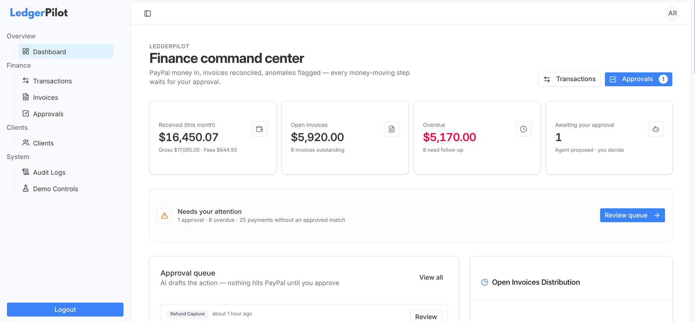
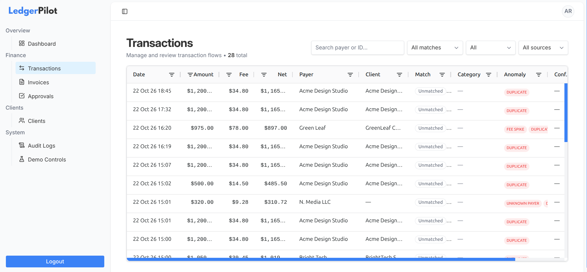
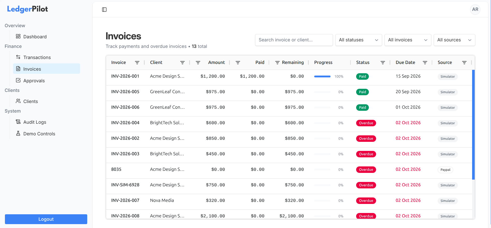
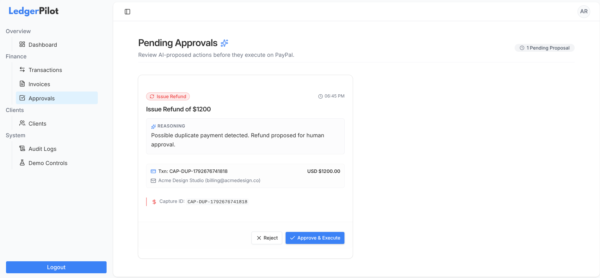
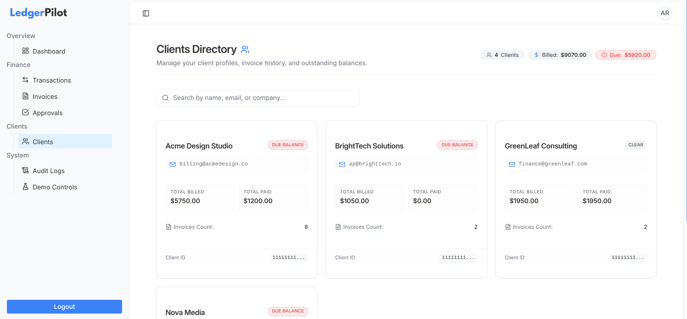
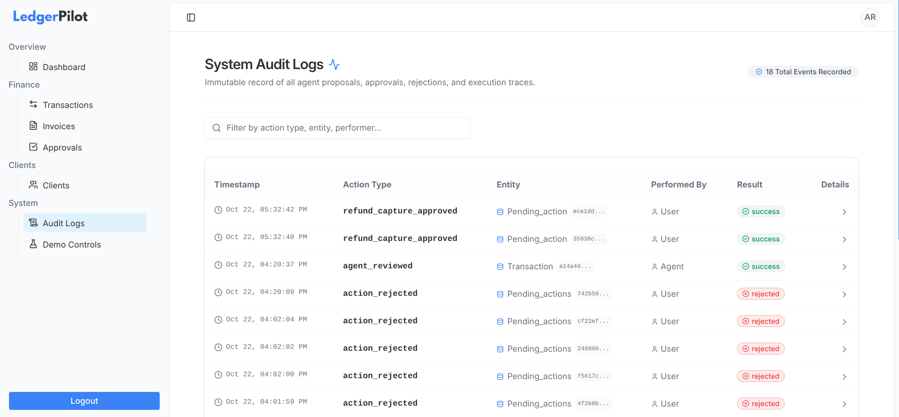

<p align="center">
  
</p>

<p align="center"><b><i>AI-assisted PayPal finance control for freelancers</i></b></p>

LedgerPilot helps freelancers turn messy PayPal activity into a clear picture of who paid what, what is still owed, and what needs a human decision before any money-moving action runs.

Rules handle the easy cases. A lightweight agent handles ambiguity. **You approve** reminders and refunds before they touch PayPal.

> **Package manager:** This project uses **pnpm** only. Do not use npm or yarn for install or scripts.

---

## Problems this project solves

Freelancers who get paid through PayPal often face the same friction:

| Problem | What goes wrong today | What LedgerPilot does |
| --------------------------- | ------------------------------------------------------------------ | ----------------------------------------------------------------------- |
| **Unmatched payments** | Money arrives with weak references; matching to invoices is manual | Ingests captures, runs deterministic rules first, then agent assistance |
| **Partial & bulk payments** | One transfer covers part of an invoice—or several at once | Tracks paid vs remaining; proposes matches for review |
| **Fees & anomalies** | High fees, duplicates, unknown payers are easy to miss | Flags fee spikes, duplicates, and unknown payers |
| **Overdue follow-up** | Chasing clients is tedious and easy to postpone | Drafts reminder actions into an **Approvals** queue |
| **Trust & control** | “AI sent something to my client / refunded money” is unacceptable | **No PayPal side effects without human approval** |
| **Auditability** | No clear history of why a match or action happened | Audit log + agent reasoning on every important step |

**In short:** less spreadsheet chaos, faster reconciliation, and a hard human-in-the-loop boundary around PayPal.

---

## Core product flow

```
PayPal webhook / Demo simulator
        → Normalize & ingest (transactions, invoices)
        → Rule engine (exact / fee-adjusted)
        → Agent (anomalies, partials, optional Gemini for ambiguous cases)
        → pending_actions when money or outreach is involved
        → Approvals UI (Approve / Reject)
        → PayPal API or DB update + audit_log
```

**Demo Controls** inject realistic PayPal-shaped events with *controlled* amounts and emails so matching and anomalies can be demonstrated reliably. PayPal Dashboard “Send test webhook” uses fixed dummy payloads and is only useful for proving the webhook pipe.

---

## Tech stack

| Layer | Technology |
| ------------------ | ---------------------------------------------------------------------------------------------- |
| App framework | **React Router** (framework mode) |
| Language | **TypeScript** |
| Package manager | **pnpm** |
| UI | **Tailwind CSS**, **shadcn/ui** (Field, Card, Badge, etc.) |
| Data grids | **AG Grid** (Transactions, Invoices) |
| Charts | **AG Charts** (Dashboard) |
| Auth & database | **Supabase** (Auth, Postgres, RLS-oriented schema) |
| Payments | **PayPal REST APIs** (sandbox webhooks, invoicing, captures, refunds) |
| AI (optional path) | **Google Gemini** (fast model, e.g. `gemini-2.0-flash-lite`) for ambiguous reconciliation only |
| Forms / validation | **React Hook Form**, **Zod** |
| Toasts | **Sonner** |

Architecture style: **service classes** (`BaseService` → Auth, Ingest, Agent, Approvals, PayPal, etc.) with structured `{ data, error }` results and `ApiError`.

---

## Features overview

- **Dashboard** — KPIs, approval pressure, anomalies, recent activity, AG Charts
- **Transactions** — Dense AG Grid, filters, row detail sheet
- **Invoices** — Paid / remaining / progress, overdue highlighting
- **Approvals** — Review agent proposals; execute or reject
- **Demo Controls** — Simulate captures, invoices, duplicates, fee spikes, overdue clock
- **Ingest pipeline** — Webhook + simulator → normalize → rules → agent
- **Audit trail** — Who did what (user / agent / rule engine)

---

<table>
  <tr>
    <td width="50%" align="center">
      <strong>Dashboard</strong><br/><br/>
      
    </td>
    <td width="50%" align="center">
      <strong>Transactions</strong><br/><br/>
      
    </td>
  </tr>
  <tr>
    <td width="50%" align="center">
      <strong>Invoices</strong><br/><br/>
      
    </td>
    <td width="50%" align="center">
      <strong>Pending Approvals</strong><br/><br/>
      
    </td>
  </tr>
  <tr>
    <td width="50%" align="center">
      <strong>Clients</strong><br/><br/>
      
    </td>
    <td width="50%" align="center">
      <strong>Audit Logs</strong><br/><br/>
      
    </td>
  </tr>
</table>

---

## Local setup

### 1. Clone the repository

```bash
git clone https://github.com/talha5978/LedgerPilot.git
cd LedgerPilot
```

Install dependencies with **pnpm**:

```bash
pnpm install
```

---

### 2. Environment variables

Create a `.env` (or `.env.local`) in the project root:

```env
NODE_ENV=development
VITE_ENV=development

SUPABASE_URL=https://xxxxxxxxxxxxxxxxx.supabase.co
SUPABASE_PUBLISHABLE_KEY=sb_publishable_xxxxxxxxxxxx

PAYPAL_API_BASE=https://api-m.sandbox.paypal.com
PAYPAL_CLIENT_ID=your_sandbox_client_id
PAYPAL_CLIENT_SECRET=your_sandbox_secret

GEMINI_API_KEY=<GEMINI_API_KEY>
GEMINI_MODEL=gemini-2.0-flash-lite
```

Match key names to whatever your app actually reads (e.g. if the code expects `SUPABASE_ANON_KEY`, use that name instead of `SUPABASE_PUBLISHABLE_KEY`).

---

### 3. Supabase CLI (via pnpm dlx)

You do **not** need a global Supabase install. Prefer **`pnpm dlx`** so the CLI version stays tied to how you run the project.

**Log in:**

```bash
pnpm dlx supabase login
```

**Initialize** (only if the repo does not already contain a `supabase/` directory):

```bash
pnpm dlx supabase init
```

**Link** this folder to your remote Supabase project:

```bash
pnpm dlx supabase link --project-ref YOUR_PROJECT_REF
```

`YOUR_PROJECT_REF` is the id in the dashboard URL:

`https://supabase.com/dashboard/project/<PROJECT_REF>`

Confirm the CLI works:

```bash
pnpm dlx supabase --version
```

---

### 4. Database migrations

Migration SQL lives under the project (typically `supabase/migrations/`), e.g. schema then optional seed.

**Push schema first** (structure only — tables, indexes, constraints, RLS):

```bash
pnpm dlx supabase db push
```

If you apply files explicitly instead:

```bash
# Schema (example filename — use the path in your repo)
pnpm dlx supabase db execute --file supabase/migrations/0001_initial_schema.sql
```

**Seed data (optional but recommended for demos):**

1. Open **Supabase Dashboard → Authentication → Users**.
2. **Add user** (email + password you will use to log into LedgerPilot).
3. Open that user and **copy the user UUID**.
4. Open the seed SQL file and set the demo profile id at the top to that UUID, for example:

```sql
-- demo_profile_id must match auth.users.id / profiles.id
-- Replace with your new user's UUID:
-- 0f060ade-7a78-4e4d-a6f0-1fb4486db461
```

5. Ensure a matching `profiles` row exists for that id (seed inserts it, or your auth trigger creates it—follow the migration design).
6. Run the seed migration:

```bash
pnpm dlx supabase db execute --file supabase/migrations/0002_seed_demo_data.sql
```

> **Important:** `profiles.id` references `auth.users.id`. Create the Auth user **before** seeding to avoid foreign-key errors.

**Generate TypeScript types** after all migrations (schema + seed if applied):

```bash
pnpm gen-types
```

Run this whenever the database schema changes so `Database` types stay in sync with Supabase.

---

### 5. PayPal Developer setup

1. Go to [https://developer.paypal.com](https://developer.paypal.com) and sign in (or create an account).
2. Open **Dashboard → Apps & Credentials**.
3. Ensure **Sandbox** is selected.
4. Create or select a **REST API** app; copy **Client ID** and **Secret** into `.env` as `PAYPAL_CLIENT_ID` and `PAYPAL_CLIENT_SECRET`.
5. Under **Sandbox accounts**, note business (merchant) and personal (buyer) accounts if you will make real sandbox payments.

**Webhooks**

1. In the app settings, open **Webhooks → Add webhook**.
2. **Webhook URL** must be a **public HTTPS** URL pointing at your ingest route, for example:

```text
https://YOUR_PUBLIC_HOST/webhooks/paypal
```

3. Subscribe at least to:

- `PAYMENT.CAPTURE.COMPLETED`
- `PAYMENT.CAPTURE.REFUNDED` (and related capture events as needed)
- `INVOICING.INVOICE.CREATED` / `PAID` / `UPDATED` / `CANCELLED` (as supported)

- **(Recommended: Select All)**

4. Save. PayPal will POST JSON events to your app when those actions occur in **sandbox**.

**Note:** Dashboard “Send test event” often uses **fixed dummy** payer emails and amounts. Prefer **Demo Controls** inside the app for matching, anomalies, and Approvals demos. Live sandbox payments exercise the real webhook path.

---

### 6. Run the app locally and expose a public URL

Start the dev server:

```bash
pnpm dev
```

Use the port printed in the terminal (often `5173` or `3000`).

**Public URL for PayPal webhooks (VS Code / Cursor port forwarding):**

1. Run the app so the local port is listening.
2. Open the **Ports** panel.
3. **Forward** the dev server port.
4. Set visibility to **Public**.
5. Copy the generated HTTPS URL.
6. Append your webhook path and paste the full URL into the PayPal webhook configuration.

Other tunnels (ngrok, Cloudflare Tunnel, etc.) work the same way: public HTTPS → local port.

---

### 7. Gemini API key (optional)

Used only when reconciliation is still ambiguous after rules and deterministic checks.

1. Open [Google AI Studio](https://aistudio.google.com/).
2. Create or select a project and generate an **API key**.
3. Set `GEMINI_API_KEY` in `.env`.
4. Optional: `GEMINI_MODEL=gemini-2.0-flash-lite` (fast, low-cost; not a heavy reasoning model).

Without a key, **rules, fee spike, duplicate, partial heuristics, and Approvals still work**. Only the LLM fuzzy/bulk path is skipped or fails softly.

---

### 8. Log in and try the product

1. Sign in with the Supabase user you created for the seed profile.
2. Open **Demo Controls** and run scenarios (exact match, fee spike, duplicate, overdue).
3. Open **Approvals** and Approve / Reject proposals.
4. Inspect **Transactions**, **Invoices**, **Dashboard** (including AG Charts), and audit-related views.

---

## Quick command cheat sheet (pnpm)

```bash
pnpm install
pnpm dlx supabase login
pnpm dlx supabase link --project-ref YOUR_PROJECT_REF
pnpm dlx supabase db push
# optional seed after Auth user + demo_profile_id update
pnpm dlx supabase db execute --file supabase/migrations/0002_seed_demo_data.sql
pnpm gen-types
pnpm dev
```

---

## How we use the Gemini API

LedgerPilot does **not** send every payment to an LLM. Gemini is a **narrow, optional assistant** for ambiguous reconciliation only. Easy cases stay deterministic, cheap, and predictable.

### Design goals

| Goal | How we implement it |
|------|---------------------|
| Low cost / low latency | Fast model (`gemini-2.0-flash-lite` by default), short prompts |
| No “deep reasoning” stack | Single-shot **JSON** response, low temperature (~0.1) |
| No direct PayPal access | Model only suggests actions; **AgentToolsService** writes to the DB |
| Human control | Fuzzy matches use lower confidence → **proposed**; money actions still go through **Approvals** |

### Components

1. **`GeminiService`** — thin HTTP wrapper around the Gemini `generateContent` API  
   - `responseMimeType: application/json`  
   - System + user prompts only (no multi-step tool-calling loop required for MVP)

2. **`AgentService.runForTransaction`** — owns when Gemini is called  
3. **`AgentToolsService`** — executes validated suggestions (`matchPayment`, `categorize`, `flagAnomaly`, etc.)

### Workflow (when a payment is ingested)

```
1. IngestService upserts transaction / invoice
2. Rule engine (exact match, fee-adjusted match)
      → strong match?  apply match (approved) → STOP  [no Gemini]
3. Deterministic agent checks
      → fee spike, duplicate, unknown payer, simple single-invoice partial
      → write annotations / pending_actions / proposed matches as needed
4. Still ambiguous AND open invoices remain?
      → YES: runLlmReconciliation() via GeminiService
      → NO:  stop
5. Gemini returns structured JSON, e.g.:
      {
        "matches": [{ "invoice_id", "amount_matched", "confidence", "reasoning" }],
        "category": "...",
        "anomaly": { "type", "reason", "confidence" } | null
      }
6. Agent validates invoice IDs (must exist in the open-invoice list)
   and amounts (must be ≤ payment amount)
7. AgentToolsService applies tools
      → matches with confidence < 0.9 stay proposed where configured
      → category / anomaly annotations on the transaction
8. Audit log records llm_reconciliation / agent_reviewed
9. User reviews Approvals (reminders, refunds) and grids (matches, anomalies)
```

### When Gemini runs

| Situation | Gemini? |
|-----------|---------|
| Exact or fee-adjusted rule match | **No** |
| Fee spike / duplicate / unknown payer (threshold rules) | **No** |
| Single clear partial (one open invoice, same email, amount &lt; invoice) | **No** (deterministic propose) |
| Bulk / fuzzy / multi-invoice ambiguity with open invoices | **Yes** |
| No open invoices left to match against | **No** |
| `GEMINI_API_KEY` missing | Soft skip / no LLM path; rest of product still works |

### What Gemini is *not* used for

- Sending invoice reminders or issuing refunds (that is **Approvals** + **PayPalService**)
- Replacing the rule engine
- Free-form chat with the user
- Writing arbitrary SQL or inventing invoice IDs (IDs are validated against loaded open invoices)

### Config

```env
GEMINI_API_KEY=<your_key>
GEMINI_MODEL=gemini-2.0-flash-lite
```

Get a key from [Google AI Studio](https://aistudio.google.com/). See **§7 Gemini API key** under Local setup.

---

## Safety principles

- **Rules first**, LLM second.
- **Pending actions** for reminders, refunds, and similar side effects.
- **Approvals** required before PayPal execution (simulator soft-success when IDs are not real).
- **Audit log** for transparency.

---

## License

See MIT liscese in the root.

---

## Acknowledgments

Built for freelancers who live in PayPal and spreadsheets—and for hackathon tracks that value real integrations (**PayPal**, **AG Grid / AG Charts**, **Supabase**) plus responsible AI (human-in-the-loop).
```
